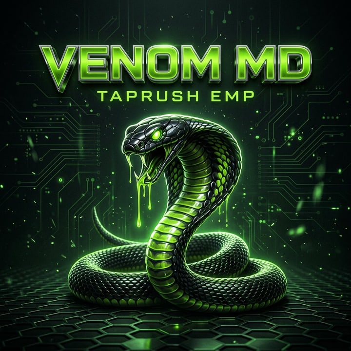

<!-- VENOM MD BOT — created by TAPRUSH EMP (Micheal) -->

<div align="center">



<br/>

[](https://git.io/typing-svg)

<br/>

[](https://github.com/MykelGoal)
[](https://youtu.be/ct4k9tfL1Fg)
[](https://wa.me/2348021016309)

<br/>

[](https://github.com/MykelGoal?tab=followers)
[](https://github.com/MykelGoal/VENOM-MD-BOT/stargazers)
[](https://github.com/MykelGoal/VENOM-MD-BOT/forks)
[](https://github.com/MykelGoal/VENOM-MD-BOT/watchers)
[](https://github.com/MykelGoal/VENOM-MD-BOT)
[](#-features)


### 🐍 Power. Speed. Control. VENOM in every command.

</div>

---

## 🐍 What is VENOM MD?

**VENOM MD BOT** is a powerful WhatsApp multi-device bot engineered for speed,
stability, security, and style. It brings **549 commands**, intelligent
automation, advanced group control, AI tools, media features, and reliable
Baileys v7 connectivity together in one bot — created and maintained by
**TAPRUSH EMP (Micheal)**.

---

## 🚀 Get Started in 3 Steps

### 1️⃣ Fork VENOM

<div align="center">

[](https://github.com/MykelGoal/VENOM-MD-BOT/fork)

</div>

### 2️⃣ Get Your Session ID

<div align="center">

[](https://session-site-2odn.onrender.com)

**[Open the official VENOM pairing site](https://session-site-2odn.onrender.com)**

</div>

> [!CAUTION]
> Your session ID controls your linked WhatsApp account. Never share it, post it,
> commit it, or expose it in screenshots and logs. VENOM has no built-in pairing
> page; the official external site above is the only pairing service for this bot.

### 3️⃣ Deploy VENOM

<div align="center">

| Platform | One-Click Deploy |
|:---:|:---:|
| **Render** | [](https://render.com/deploy?repo=https%3A%2F%2Fgithub.com%2FMykelGoal%2FVENOM-MD-BOT) |
| **Koyeb** | [](https://app.koyeb.com/deploy?type=git&builder=dockerfile&repository=github.com/MykelGoal/VENOM-MD-BOT&branch=main&name=venom-md-bot&service_type=web&ports=10000%3Bhttp%3B%2F&env%5BPORT%5D=10000&env%5BSESSION_NAMESPACE%5D=venom) |
| **Heroku** | [](https://heroku.com/deploy?template=https://github.com/MykelGoal/VENOM-MD-BOT) |
| **Railway** | [](https://railway.app/new/template?template=https://github.com/MykelGoal/VENOM-MD-BOT) |
| **Panel / VPS** | [](https://github.com/MykelGoal/VENOM-MD-BOT/archive/refs/heads/main.zip) |

</div>

Add these private environment variables before starting the deployment:

| Variable | What to enter |
|---|---|
| `SESSION_ID` | Private value from the official VENOM pairing site |
| `MODS` | Your WhatsApp owner number, digits only |
| `SESSION_NAMESPACE` | A short name such as `venom` |
| `MONGODB` or `MONGO_URI` | Optional hosted MongoDB URL for persistent storage |

Render reads the included [`render.yaml`](render.yaml). Koyeb builds the included
[`Dockerfile`](Dockerfile). On either platform, confirm that port `10000` is
exposed and add the private variables above before deployment.

> [!NOTE]
> MongoDB is optional. Without a MongoDB URL, VENOM uses local JSON storage and
> local session files, so the bot can start immediately. Hosted files may be
> lost when the service is redeployed; add MongoDB later if you need durable
> settings or session backup. Never use `mongodb://127.0.0.1:27017/venom` as a
> hosted database URL.

---

## ✨ Features

- **549 commands** across 24 categories
- **Group control** — moderation, anti-link, anti-delete, welcomes, warnings,
  roles, and admin tools
- **AI tools** — intelligent chat and creative commands with multiple provider
  support
- **Media powerhouse** — download, convert, edit, compress, sticker, audio,
  video, and image tools
- **Secure sessions** — validated Baileys v7 credentials with local and
  MongoAuth persistence
- **Built to stay online** — reconnect watchdogs, graceful recovery, and
  bounded caches
- **Plugin architecture** — add reviewed commands without rebuilding the core
- **Multi-platform deployment** — Render, Koyeb, Heroku, Railway, Docker, VPS,
  and hosting panels

---

## 🛠️ Manual Deployment

**Requirements:** Node.js 22+, npm, and a secondary WhatsApp number.
MongoDB is optional; configure it only when you want durable data and remote
session backup.

```bash
# Clone and enter the project
git clone https://github.com/MykelGoal/VENOM-MD-BOT.git
cd VENOM-MD-BOT

# Configure VENOM
cp .env.example .env
# Add your SESSION_ID and MODS to .env; MONGODB is optional

# Install, verify, and start
npm ci
npm test
npm start
```

You can also run VENOM with Docker:

```bash
docker build -t venom-md-bot .
docker run --rm -p 10000:10000 --env-file .env \
  -v venom-session:/app/System/session venom-md-bot
```

---

<details>
<summary><b>⚙️ Environment Configuration</b></summary>

| Variable | Required | Default | Purpose |
|---|---:|---|---|
| `MONGODB` or `MONGO_URI` | No | local VENOM URL (development only) | Optional persistent data and private session backup storage |
| `SESSION_ID` | First link | blank | Private credential from the official pairing site |
| `SESSION_NAMESPACE` | No | `venom` | Safe local and MongoAuth storage name |
| `MODS` | No | creator number | Comma-separated deployment owner numbers |
| `PREFIX` | No | `.` | Command prefix |
| `PACKNAME` | No | `VENOM MD BOT` | Sticker pack name |
| `AUTHOR` | No | creator credit | Sticker author |
| `GEMINI_API` | No | blank | Gemini keys, comma-separated |
| `OPENAI_API` | No | blank | OpenAI keys, comma-separated |
| `CLAUDE_API` | No | blank | Anthropic keys, comma-separated |
| `TENOR_API_KEY` | No | blank | Tenor keys, comma-separated |
| `OPENWEATHER_API_KEY` | No | blank | OpenWeather key |
| `PIXABAY_API_KEY` | No | blank | Pixabay key |
| `TIKTOK_API_KEY` | No | blank | TikTok provider keys, comma-separated |
| `MEDIA_MAX_MB` | No | `64` | Maximum inbound or downloaded media size |
| `FFMPEG_PATH` | No | auto-detected | Optional FFmpeg executable path |
| `PORT` | No | `10000` | Health server port |
| `TRUST_PROXY` | No | `false` | Enable only behind one trusted reverse proxy |

See [`.env.example`](.env.example) for every maintenance setting.

</details>

<details>
<summary><b>🧩 Add a Reviewed Command</b></summary>

Create a JavaScript file in `Plugins/`:

```js
export default {
  name: "hello",
  alias: ["hello", "hi"],
  uniquecommands: ["hello"],
  description: "Send a greeting",
  start: async (Venom, message, { inputCMD }) => {
    if (inputCMD === "hello" || inputCMD === "hi") {
      await message.reply("Hello from VENOM MD BOT!");
    }
  },
};
```

Run `npm test` and restart VENOM after changing a plugin. Remote chat-installed
JavaScript and real-time `eval` are intentionally disabled for safety.

</details>

---

## 👨‍💻 Developer

| Role | Credit |
|---|---|
| **Creator & Maintainer** | [TAPRUSH EMP (Micheal)](https://github.com/MykelGoal) |
| **WhatsApp** | [2348021016309](https://wa.me/2348021016309) |
| **YouTube Tutorial** | [Watch here](https://youtu.be/ct4k9tfL1Fg) |
| **Core Library** | [WhiskeySockets/Baileys](https://github.com/WhiskeySockets/Baileys) |

---

## ⚖️ Notice & License

> VENOM MD BOT is not affiliated with WhatsApp or Meta. Use a secondary number,
> obey WhatsApp's terms, and do not misuse this software. Automated accounts can
> be restricted or banned.

This project is MIT licensed and retains the required Atlas-MD upstream credit.
See [`LICENSE`](LICENSE) and [`THIRD_PARTY_NOTICES.md`](THIRD_PARTY_NOTICES.md)
for complete attribution.

<div align="center">

### 《 POWERED BY TAPRUSH EMP (MICHEAL) 》

**VENOM MD BOT — Power. Speed. Control.**

</div>
