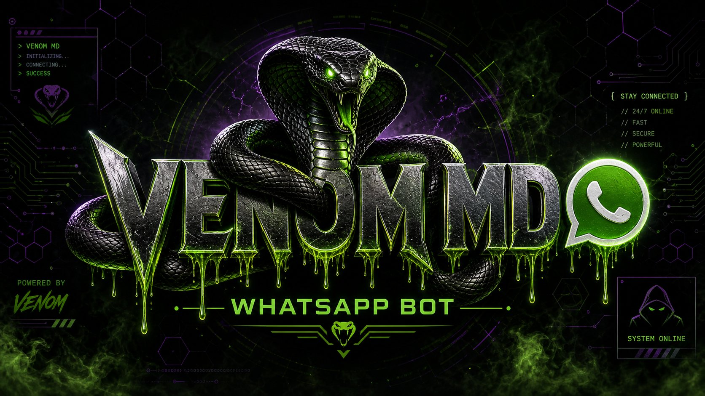

<div align="center">



# ⚡ VENOM MD BOT

**A fast and powerful WhatsApp multi-device bot.**

[](https://nodejs.org)
[](https://github.com/WhiskeySockets/Baileys)
[](LICENSE)

<!-- ===== LIVE STATS ===== -->
<a href="https://www.youtube.com/@venommdbot?sub_confirmation=1" target="_blank">
  
</a>
<a href="https://github.com/MykelGoal/VENOM-MD-BOT/stargazers">
  
</a>
<a href="https://github.com/MykelGoal/VENOM-MD-BOT/network/members">
  
</a>

<!-- ===== CALL TO ACTION ===== -->
<table>
<tr>
<td align="center" width="280">

**📺 Love the tutorials?**

<a href="https://www.youtube.com/@venommdbot?sub_confirmation=1" target="_blank">
  
</a>

<sub>Watch on <b>VENOM MD Tech</b></sub>

</td>
<td align="center" width="280">

**⭐ Enjoy the bot?**

<a href="https://github.com/MykelGoal/VENOM-MD-BOT">
  
</a>

<sub>Starring helps others find VENOM MD</sub>

</td>
</tr>
</table>

[**GET SESSION ID**](https://session-site-2odn.onrender.com) · [**FORK REPOSITORY**](https://github.com/MykelGoal/VENOM-MD-BOT/fork)

</div>

---

## 🐍 About

VENOM MD BOT is a WhatsApp bot built with Baileys. It includes **631 commands** for group management, media, AI, games, downloads and useful everyday tools.

### Main features

- Group administration, welcome messages and anti-link protection
- Stickers, media conversion and download tools
- AI commands with multiple optional providers
- Games, economy, search and utility commands
- Local storage with optional MongoDB backup
- Support for Render, Railway, Koyeb, Heroku, Docker and VPS

---

## 🔑 Get a Session ID

<div align="center">

[](https://session-site-2odn.onrender.com)

</div>

1. Open the session website.
2. Link your WhatsApp account using QR or phone-number pairing.
3. Copy the generated session ID.
4. Add it to your deployment as `SESSION_ID`.

> **Keep your session ID private.** Anyone with it may be able to access your WhatsApp account.

---

## 🚀 Quick Deploy

| Platform | Deploy |
|---|---|
| **Render** | [](https://render.com/deploy?repo=https%3A%2F%2Fgithub.com%2FMykelGoal%2FVENOM-MD-BOT) |
| **Railway** | [](https://railway.app/new/template?template=https://github.com/MykelGoal/VENOM-MD-BOT) |
| **Koyeb** | [](https://app.koyeb.com/deploy?type=git&builder=dockerfile&repository=github.com/MykelGoal/VENOM-MD-BOT&branch=main&name=venom-md-bot&ports=10000%3Bhttp%3B%2F) |
| **Heroku** | [](https://heroku.com/deploy?template=https://github.com/MykelGoal/VENOM-MD-BOT) |

For **Render Quick Deploy**, enter both values when Render asks for environment variables:

- `SESSION_ID`: the private session ID generated by the session website.
- `OWNER_NUMBER`: your WhatsApp number with country code, digits only (for example, `2348021016309` — do not include `+`).

The Render blueprint deliberately marks `OWNER_NUMBER` as a deploy-time secret, so each person who forks the repository can provide their own number instead of using the repository owner's number. If Render does not show the field, add `OWNER_NUMBER` manually under **Environment Variables** before deploying.

---

## ⏰ Run 24/7 with UptimeRobot (free)

Free hosting platforms sleep idle apps. VENOM MD keeps itself awake by pinging its own `/health` endpoint every 4 minutes, and you can add extra protection with a free [UptimeRobot](https://uptimerobot.com) monitor:

1. Deploy the bot and copy your public URL (for example `https://your-app.onrender.com`).
2. Create a free UptimeRobot account → **Add New Monitor**.
3. Type: **HTTP(s)** — URL: `https://your-app.onrender.com/health` — interval: **5 minutes**.
4. Save. UptimeRobot now pings the bot forever, so it never sleeps.

Optionally set a `PING_URL` environment variable to any URL the bot should ping itself (an UptimeRobot monitor or your app URL) for double cover.

---

## 🛠️ Manual Installation

Requires **Node.js 20.18+**. FFmpeg is recommended for media commands.

```bash
git clone https://github.com/MykelGoal/VENOM-MD-BOT.git
cd VENOM-MD-BOT
npm ci
cp .env.example .env
npm start
```

Add at least these values to `.env`:

```env
SESSION_ID=your_private_session_id
OWNER_NUMBER=2348021016309
PREFIX=.
COMMAND_MODE=public
```

See [`.env.example`](.env.example) for optional settings and AI keys. After startup, send `.menu` in WhatsApp to view all commands.

---

## ⚠️ Notice

Use this bot only with accounts and groups you are authorized to manage. Do not use it to spam, abuse services or violate WhatsApp's terms.

## 📜 Credits

- **Developer:** [TAPRUSH EMP (Micheal)](https://github.com/MykelGoal)
- **Core library:** [Baileys](https://github.com/WhiskeySockets/Baileys)
- **YouTube:** [VENOM MD Tech](https://www.youtube.com/@venommdbot?sub_confirmation=1)
- **License:** [MIT](LICENSE)

<div align="center">

<a href="https://www.youtube.com/@venommdbot?sub_confirmation=1" target="_blank">
  
</a>
<a href="https://github.com/MykelGoal/VENOM-MD-BOT/stargazers">
  
</a>

**VENOM MD BOT — Built by TAPRUSH EMP**

</div>
